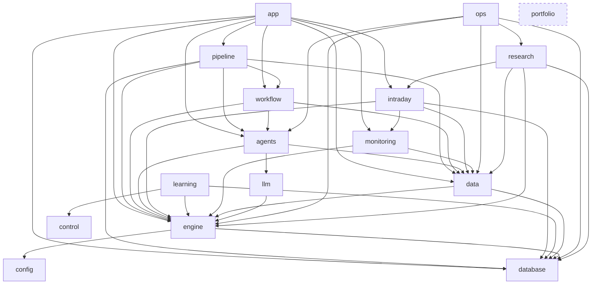

# Dependency map

Measured from the real imports (anything under `if TYPE_CHECKING:` ignored) on 2026-10-15. **There are no cycles between
packages.** An arrow means "imports".



`portfolio` (dashed) imports nothing from the other packages, and only `app/portfolio_agent.py` imports it.

## The rules, and what enforces them

`tests/test_layering.py` fails the build when any of these is broken:

| Rule | Why |
| --- | --- |
| Production code (`agents`, `data`, `database`, `engine`, `intraday`, `llm`, `monitoring`) never imports `research`, `ops` or `learning` | An experiment cannot change what trades |
| `engine` imports no `agents`, `llm`, `data`, `app`, `research`, `ops`, `monitoring` or `intraday` | The risk engine and broker stay a leaf you can reason about alone |
| `data` imports no `agents`, `llm`, `app`, `research`, `ops`, and not `pipeline`/`workflow` | Data does not know who uses it |
| `learning` imports no `app`, `research`, `ops`, `monitoring`, `intraday`, `llm` | Nothing trades through the learning layer |
| `llm` imports no `agents`, `data`, `app`, `research`, `ops`, `monitoring`, `intraday`, `database` | The client is reusable and knows nothing about trading |
| `src/` root holds only `config, control, logging_setup, pipeline, results, runner, versions, workflow` | New code goes in a package |
| No module imports a private (`_name`) from another | Boundaries are public APIs |
| No import cycles between modules | |
| `portfolio` imports nothing outside itself; only `app/portfolio_agent.py` imports it | The real-account agent has no path to the paper broker or orders |
| `workflow` does not import `pipeline` | The graphs see the application only through `CycleServices` |

## Checking it yourself

```
python -m pytest tests/test_layering.py -q
```

`tests/test_layering.py` builds this same graph from the imports, so the rules above cannot drift from the code.
